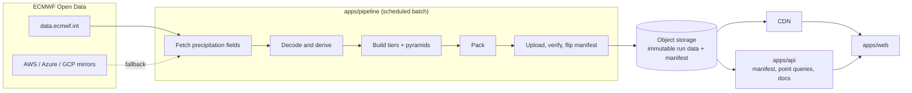

# Design Document: Precipitation Forecast

| | |
|---|---|
| Status | v0.1 baseline |
| Date | 2026-11-06 |
| Owner | Atul Raj |
| Audience | Primarily users in India |

This is the guiding document for the project. When a build decision is unclear, resolve it against sections 3 (principles) and 10 (cost guardrails). When a decision here changes, record it as a numbered file in `docs/decisions/` and update this document.

Legend used below: **Decided** = agreed with the owner. **Proposed** = my recommendation, not yet confirmed. **Verify** = a claim or number that must be checked before relying on it.

---

## 1. Vision and goals

A web app that turns ECMWF Open Data precipitation forecasts (IFS and AIFS) into an engaging, explorable experience: watch rain move across India, zoom into your city, and compare what the two models expect.

| ID | Goal |
|---|---|
| G1 | Fast and detailed for India. Everything else gets a coarse view. |
| G2 | Engaging: animation, smooth zoom, a distinctive visual identity. |
| G3 | Cheap to run in production, paid from personal funds. |
| G4 | Honest: never imply more precision than the model or the data has. |
| G5 | IFS vs AIFS comparison is a first-class feature. |

**Non-goals for v1:** user accounts, historical archive, nowcasting, variables other than precipitation, native mobile apps, global high-resolution data, ensemble/probability views (designed for, built later).

## 2. Constraints

- **Budget:** personal funds. Target steady-state cost is in section 10.
- **Team:** one developer. Python is comfortable. Operational simplicity beats cleverness.
- **Audience:** India. Times shown in IST, stored in UTC.
- **Upstream (ECMWF Open Data), see `data-sources.md`:**
  - Runs at 00/06/12/18 UTC, GRIB2 files.
  - Only the last 12 runs are retained (about 2-3 days).
  - Forecast horizon is 15 days (360 h). There is no longer-range product.
  - IFS 0.1° is published about 2 h after 0.25° and is split into separate surface/pressure-level files. AIFS is 0.25° only.
  - Licence CC-BY-4.0 plus ECMWF Terms of Use: attribution required, commercial use allowed.
  - Files are global. As far as I know there is no server-side area subsetting (**Verify**).
  - The portal limits concurrent connections; AWS, Azure and Google Cloud mirrors exist as fallback.

## 3. Design principles (the guiding lights)

1. **Spend precision where the user is looking.** Resolution in space and time is a budget. Coarse by default, fine on demand, applied equally to the map and the timeline.
2. **Do the work at ingest, not at request.** The pipeline pre-builds everything. Serving is just reading files.
3. **Static first.** Data is served as immutable files from object storage through a CDN. The API only handles what cannot be a file.
4. **Failure isolation.** If the pipeline fails, the site keeps serving the last good forecast, clearly labelled with its age.
5. **Forget the past, look ahead.** Keep the latest run and the previous run. No archive.
6. **Honest precision.** The UI states the native resolution of what is shown and never presents upscaled data as detail.
7. **Contract first.** The OpenAPI spec is written and reviewed before any endpoint is implemented.
8. **Measure, then optimise.** Numbers in this document that are guesses are marked **Verify** and replaced with measurements in Phase 3.

## 4. Requirements

### 4.1 Functional

| ID | Requirement | Phase |
|---|---|---|
| FR1 | Map of precipitation for a chosen model and time, India in focus with global context | 4 |
| FR2 | Time slider and play/pause animation | 4 |
| FR3 | Zoom with progressive refinement (coarse tile instantly, sharper tile fades in) | 4 |
| FR4 | Point forecast: search, click or geolocate to get a time series for both models | 3-4 |
| FR5 | IFS vs AIFS comparison (side-by-side or difference view) | 4 |
| FR6 | Show model run time and data age, in IST | 4 |
| FR7 | Visible ECMWF attribution as required by the licence (**Verify** exact wording) | 4 |
| FR8 | "What changed since the previous run" view (**Proposed**) | post-v1 |

### 4.2 Non-functional (all targets are **Proposed**)

| ID | Target |
|---|---|
| NFR1 | Freshness: a new run is visible within 30 min of it being fully available upstream |
| NFR2 | First useful map on a mid-range phone over 4G in under 3 s |
| NFR3 | Tile fetch at p95 under 300 ms (CDN hit) |
| NFR4 | Steady-state cost within the guardrail in section 10 |
| NFR5 | Site stays up (stale but labelled) when the pipeline or ECMWF is down |
| NFR6 | Accessible: colour-blind-safe palette, respects reduced-motion, keyboard operable |
| NFR7 | Privacy: user location is used only in the browser, never sent to our servers |

## 5. Data design

### 5.1 Tiers (**Decided** as baseline)

Detail is allocated on a space x time grid. Region boxes are configuration, not code.

| Tier | Space | Time | Models | Coverage |
|---|---|---|---|---|
| 0 | 0.5° | 6-hourly to day 7, daily totals to day 15 | IFS + AIFS | Global |
| 1 | 0.25° | IFS 3-hourly / AIFS 6-hourly to day 7, daily to day 15 | IFS + AIFS | South Asia (about 35° x 40°) |
| 2 | 0.1° | 3-hourly to day 6 | IFS | India (about 6-38°N, 67-98°E) |

Each tier is stored as a pyramid (overview levels) so zoom has intermediate levels. Overview levels add about one third to storage.

Why days 8-15 are daily totals: detail that far out is mostly noise, so coarse aggregates are both cheaper and more honest.

### 5.2 Derived product

- The pipeline converts ECMWF total precipitation into per-interval precipitation in millimetres, on a UTC time axis.
- **Verify:** the exact `tp` definition, units and accumulation convention for IFS and for AIFS. I expect accumulation since forecast start in metres, but this has not been confirmed for this design.
- Values are quantised into a compact integer encoding (scheme decided in Phase 3 after measuring accuracy against file size).

### 5.3 Retention (**Decided**)

- Keep the latest run and the previous run per model. Delete older.
- Raw GRIB is deleted after processing. ECMWF's 12-run window is the safety net for re-processing.

### 5.4 Size estimate (**Verify**)

Assuming 0.5-1 byte per grid point after packing: about 17-34 MB per run for all tiers, so about 35-70 MB for the two kept runs. Real numbers come from Phase 3.

## 6. Architecture

### 6.1 Components

| Component | Responsibility | Never does |
|---|---|---|
| `apps/pipeline` | Detect new runs, fetch, decode, derive, build tiers, publish | Serve HTTP |
| `apps/api` | Serve manifest, point time series, API docs. Thin and read-only | Decode GRIB, compute tiles |
| `apps/web` | Render, interact, prefetch | Process data |
| `packages/api-contract` | OpenAPI spec shared by api and web | Contain logic |
| Object storage + CDN | Hold and deliver immutable data | |

Boundary rules are in `STRUCTURE.md`.

### 6.2 Run lifecycle in the pipeline

1. **Detect** a new run (poll or notification). Runs are identified by `model/YYYYMMDDHH`.
2. **Fetch** only the precipitation fields needed, not whole files.
3. **Decode and derive** per-interval mm.
4. **Build** each tier and its pyramid. Tiers are independent: tier 0 and 1 can publish before tier 2 arrives.
5. **Pack** tiles into a few larger files (avoids per-object request costs, see section 10).
6. **Upload** to a new, versioned path.
7. **Verify** (counts, checksums, value-range sanity).
8. **Publish** by atomically updating the manifest to point at the new run.
9. **Clean up** runs older than the previous one.

The pipeline must be idempotent and resumable: re-running a run produces the same result and a crash mid-way never leaves a half-published run visible.

### 6.3 Caching model (central to cost)

- Run data lives at **versioned, immutable paths** and is cached for a long time.
- Only the small **manifest** is mutable, with a short cache lifetime (order of a minute, **Proposed**).
- Result: nearly all traffic is served from CDN cache, and origin reads stay small.

## 7. API design

Principles:
- Read-only, versioned under `/v1`, documented by the OpenAPI spec in `packages/api-contract` (served as interactive docs).
- Tiles are **not** served through the API. The client reads them from the CDN using paths given in the manifest.
- Consistent error format, input validation, and basic rate limiting.

Endpoint sketch (non-binding, finalised in the contract in Phase 3):

| Endpoint | Purpose |
|---|---|
| `GET /v1/manifest` | Available models, runs, tiers, steps, tile locations, run and update times |
| `GET /v1/point?lat=&lon=` | Time series for both models at a location, using the best tier covering it |
| `GET /v1/health` | Liveness and data freshness |

## 8. Frontend and experience design

The frontend stack is decided in Phase 2. The experience principles below hold regardless.

- **Progressive refinement.** On zoom or time change, show the nearest coarser data immediately and cross-fade to the finer tile when it arrives. The motion hides latency and signals loading honestly.
- **Same idea in time.** Daily totals first, 3-hourly frames when the user scrubs in.
- **Prefetch.** Fetch neighbouring tiles and the next few time frames around the user's viewport and play head. Geography informs browser prefetch, not server computation.
- **Honest labelling.** Show the native resolution and model next to the map. Do not present upscaled data as detail.
- **Distinct identity.** A deliberate visual language for rain, not a default weather-map look. Colour-blind-safe, reduced-motion aware.
- **Always show data age and run time**, in IST.
- Attribution to ECMWF is always visible.

## 9. Scaling path (Phase 5 preview)

| Pressure | Lever |
|---|---|
| More users | CDN absorbs it. Cost stays flat while caching works. |
| Pipeline too slow | Parallelise per tier and per model, then a bigger machine. |
| Sharper India | Raise tier 2 coverage or time range via config. |
| New regions | Add a tier entry in config. |
| Uncertainty views | Add ENS and probability products as new data layers. |
| API load | Keep it thin. Cache point queries. |

Order of attack: measure first, then fix the largest cost or latency item, then repeat.

## 10. Cost model and guardrails

Estimates from the cost discussion (prices checked 2026-11-06, re-verify before committing):

| Scenario | Monthly |
|---|---|
| Demo, a few users | about $1-8 |
| About 1k daily visitors | about $7-8 |
| About 10k daily visitors, caching works | about $7-10 |
| About 10k daily visitors, caching broken | about $35-40 |

**Target (Proposed):** steady-state at or under $10 per month, with a billing alert at $15.

**Guardrails (the rules that keep us there):**
1. No per-request computation of tiles or maps.
2. Long-lived cache headers on immutable data are mandatory and tested.
3. Pack tiles into few large objects. Never write thousands of tiny files per run.
4. No autoscaling services. Prefer fixed-price compute and free tiers.
5. Egress is served by the CDN or object store with free egress, not by the VM.
6. Billing alerts on every paid service from day one.
7. Re-measure cost after each phase.

## 11. Phases and exit criteria

| Phase | Deliverable | Exit criteria |
|---|---|---|
| 1 | Project structure | Layout and rules reviewed. **Done.** |
| 2 | Stack decisions | One ADR per stack decision with rejected alternatives. Hosting shape chosen. |
| 3 | Pipeline + API | Real IFS and AIFS run processed end to end. Manifest published. Documented OpenAPI. Measured size, run time and cost replace section 5.4 estimates. |
| 4 | Web UI | FR1-FR7 working on real data. NFR2, NFR3, NFR6 met. |
| 5 | Optimise and scale | Cost target holds under a load test. Bottlenecks measured and addressed. |

## 12. Risks

| Risk | Impact | Mitigation |
|---|---|---|
| ECMWF changes format, URLs or retention | Pipeline breaks | Pin the client library, alert on failure, serve stale-but-labelled |
| Partial or delayed runs (0.1° arrives late) | Inconsistent display | Tier-independent publishing, manifest records per-tier status |
| `tp` convention misunderstood | Wrong rainfall numbers | Verify against ECMWF docs and cross-check with a known case in Phase 3 |
| Cache misconfiguration | Cost spike | Tests on cache headers, billing alert |
| Pipeline slower than the run interval | Falls behind | Measure early, parallelise by tier |
| Provider lock-in | Hard to move | Use S3-compatible storage API, keep storage behind a thin interface |
| Attribution non-compliance | Licence breach | Build attribution into the UI from the first release |

## 13. Open questions and items to verify

1. `tp` definition, units, accumulation for IFS and AIFS.
2. Bytes per point after packing, and whole-pipeline run time (measure on a small VM).
3. Whether download of single fields by byte range is fast enough for 4 runs/day.
4. Exact attribution wording required by ECMWF.
5. Hosting: default is S3-compatible object storage (Cloudflare R2 as first choice) with a CDN, plus one small VM. Provider-neutral interface kept. Owner to confirm.
6. Exact India and South Asia boxes (config, easy to change).
7. Keep the previous run for the "what changed" view. Owner to confirm.
8. Map renderer and frontend framework: Phase 2.
9. Should uncertainty (probability products) enter v1.1?

## 14. Decision log

| # | Decision | Status |
|---|---|---|
| 0001 | Monorepo with three apps and a contract package | Proposed (accepted by structure review) |
| 0002 | Tiered resolution, time policy and retention | Accepted as baseline |
| 0003 | Static-first delivery and cost guardrails | Accepted as baseline |

## 15. Glossary

- **IFS:** ECMWF's physics-based Integrated Forecasting System. HRES is its deterministic high-resolution run, ENS its 50-member ensemble.
- **AIFS:** ECMWF's machine-learning forecast model.
- **Run:** one model execution, identified by model and start time (00/06/12/18 UTC).
- **Step:** forecast lead time in hours from run start.
- **tp:** total precipitation field.
- **Tier:** a (resolution, time cadence, region) bundle in section 5.1.
- **Tile:** a small spatial chunk of a field at one zoom level.
- **Manifest:** the small mutable file that says which immutable run data is current.
