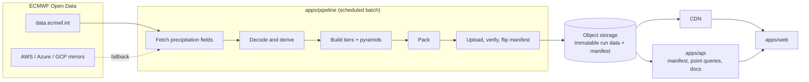

# Design Document: Precipitation Forecast

| | |
|---|---|
| Status | v0.6 (Phase 3 built, real-data checked; ready for review) |
| Date | 2026-11-06 |
| Owner | Atul Raj |
| Audience | Primarily users in India |

This is the guiding document for the project. When a build decision is unclear, resolve it against sections 3 (principles) and 10 (cost guardrails). When a decision here changes, record it as a numbered file in `docs/decisions/` and update this document.

Legend used below: **Decided** = agreed with the owner. **Proposed** = my recommendation, not yet confirmed. **Verify** = a claim or number that must be checked before relying on it.

---

## 1. Vision and goals

A web app that turns ECMWF Open Data precipitation forecasts (IFS and AIFS) into an engaging, explorable experience: watch rain move across India, zoom into your city, and see what the forecast expects. ECMWF IFS and AIFS are the starting sources; one source is shown at a time.

| ID | Goal |
|---|---|
| G1 | Fast and detailed for India. Everything else gets a coarse view. |
| G2 | Engaging: animation, smooth zoom, a distinctive visual identity. |
| G3 | Cheap to run in production, paid from personal funds. |
| G4 | Honest: never imply more precision than the model or the data has. |
| G5 | One source at a time, with an easy switch between sources (IFS, AIFS, more later). Cross-source comparison is out of scope (owner decision, ADR 0012). |
| G6 | Source-agnostic: fetch from whichever source and access path gives the best cost, quality and correctness. |

**Non-goals for v1:** user accounts, historical archive, nowcasting, variables other than precipitation, native mobile apps, global high-resolution data, ensemble/probability views (designed for, built later).

## 2. Constraints

- **Budget:** personal funds. Target steady-state cost is in section 10.
- **Team:** one developer. Python is comfortable. Operational simplicity beats cleverness.
- **Frontend:** Angular (owner's choice, ADR 0004).
- **Hosting:** Cloudflare R2 plus CDN on a custom domain (owner confirmed, ADR 0003).
- **Sources:** not tied to one provider or one download location (section 5.5).
- **Audience:** India. Times shown in IST, stored in UTC.
- **Upstream (ECMWF Open Data), see `data-sources.md`:**
  - Runs at 00/06/12/18 UTC, GRIB2 files.
  - Only the last 12 runs are retained (about 2-3 days).
  - Forecast horizon is 15 days (360 h). There is no longer-range product.
  - IFS 0.1° is published about 2 h after 0.25° and is split into separate surface/pressure-level files. AIFS is 0.25° only.
  - Licence CC-BY-4.0 plus ECMWF Terms of Use: attribution required, commercial use allowed.
  - Files are global. As far as I know there is no server-side area subsetting (**Verify**).
  - The portal limits concurrent connections; AWS, Azure and Google Cloud mirrors exist as fallback.

## 3. Design principles (the guiding lights)

1. **Spend precision where the user is looking.** Resolution in space and time is a budget. Coarse by default, fine on demand, applied equally to the map and the timeline.
2. **Do the work at ingest, not at request.** The pipeline pre-builds everything. Serving is just reading files.
3. **Static first.** Data is served as immutable files from object storage through a CDN. The API only handles what cannot be a file.
4. **Failure isolation.** If the pipeline fails, the site keeps serving the last good forecast, clearly labelled with its age.
5. **Forget the past, look ahead.** Keep the latest run and the previous run. No archive.
6. **Honest precision.** The UI states the native resolution of what is shown and never presents upscaled data as detail.
7. **Contract first.** API request and response models and the generated OpenAPI spec are reviewed before endpoint logic is written. The spec is a committed file, checked in CI for drift (ADR 0007).
8. **Measure, then optimise.** Numbers in this document that are guesses are marked **Verify** and replaced with measurements in Phase 3.
9. **Source-agnostic.** A source (what we show) is separate from an access path (where we fetch it). Both are configuration, and every source passes a licence check before it is enabled.

## 4. Requirements

### 4.1 Functional

| ID | Requirement | Phase |
|---|---|---|
| FR1 | Map of precipitation for a chosen model and time, India in focus with global context | 4 |
| FR2 | Time slider and play/pause animation | 4 |
| FR3 | Zoom with progressive refinement (coarse tile instantly, sharper tile fades in) | 4 |
| FR4 | Point forecast: search, click or geolocate to get a time series for each enabled source | 3-4 |
| FR5 | Switch between enabled sources; each view shows one source with its run time and native resolution | 4 |
| FR6 | Show model run time and data age, in IST | 4 |
| FR7 | Visible ECMWF attribution as required by the licence (**Verify** exact wording) | 4 |
| FR8 | "What changed since the previous run" view (**Proposed**) | post-v1 |

### 4.2 Non-functional (all targets are **Proposed**)

| ID | Target |
|---|---|
| NFR1 | Freshness: a new run is visible within 30 min of it being fully available upstream |
| NFR2 | First useful map on a mid-range phone over 4G in under 3 s |
| NFR3 | Tile fetch at p95 under 300 ms (CDN hit) |
| NFR4 | Steady-state cost within the guardrail in section 10 |
| NFR5 | Site stays up (stale but labelled) when the pipeline or ECMWF is down |
| NFR6 | Accessible: colour-blind-safe palette, respects reduced-motion, keyboard operable |
| NFR7 | Privacy: user location is used only in the browser, never sent to our servers |
| NFR8 | CDN cache hit ratio for tiles at or above 95% in steady state, verified by an automated check |

## 5. Data design

### 5.1 Tiers (**Decided** as baseline)

Detail is allocated on a space x time grid. Region boxes are configuration, not code. Tiers are defined per source; the table below is the ECMWF baseline.

| Tier | Space | Time | Models | Coverage |
|---|---|---|---|---|
| 0 | 0.5° | 6-hourly to day 7, daily totals to day 15 | IFS + AIFS | Global |
| 1 | 0.25° | IFS 3-hourly / AIFS 6-hourly to day 7, daily to day 15 | IFS + AIFS | South Asia (about 35° x 40°) |
| 2 | 0.1° | 3-hourly to day 6 | IFS | India (about 6-38°N, 67-98°E) |

Each tier is stored as a pyramid (overview levels) so zoom has intermediate levels. Overview levels add about one third to storage.

Why days 8-15 are daily totals: detail that far out is mostly noise, so coarse aggregates are both cheaper and more honest.

### 5.2 Derived product

- The pipeline converts ECMWF total precipitation into per-interval precipitation in millimetres, on a UTC time axis.
- **Verified on real files (2026-11-06):** `tp` is accumulated from forecast start for both models. IFS is in metres, AIFS in kg m-2 (= mm). Both are lossy-packed (12 bits), so differences of accumulations carry a small packing error; the pipeline tolerates the sum of the two packing steps and still fails loudly on anything larger (`ConventionError`). Details in ADR 0008.
- Values are quantised to one byte per value, log-spaced (log8, at most 2.2% relative error). Decided in ADR 0008; format in `docs/data-format.md`.

### 5.3 Retention (**Decided**)

- Keep the latest run and the previous run per model. Delete older.
- Raw GRIB is deleted after processing. ECMWF's 12-run window is the safety net for re-processing.

### 5.4 Size (measured on synthetic data, Phase 3)

Synthetic, one run, production tiers: 26.8 MB (IFS 16.2, AIFS 10.5). Real fields turned out **2.3-2.8x larger per frame** than synthetic ones (noisier rain), so the working estimate for one run of both sources is **about 40-70 MB**, and about **80-140 MB** for the two kept runs, still a rounding error against R2's free 10 GB. The estimate is extrapolated from real 0.25 degree fields (4 frames), not measured on a full run; the 0.1 degree tier is not yet measured on real data. Pipeline for both sources on synthetic data: 30 s wall, 525 MB peak, excluding real download time. Each extra source adds a similar amount, so storage stays small; pipeline time grows faster than storage.

### 5.5 Sources and access paths

We are not tied to one provider. Two terms keep this clear:

- **Source:** a forecast product we display, for example `ecmwf-ifs` or `ecmwf-aifs`.
- **Access path:** where we fetch that source's files from, for example the ECMWF portal or a cloud mirror.

Each source has an ordered list of access paths in config, chosen by:

| Criterion | Question |
|---|---|
| Cost | What does it cost us to pull the data? |
| Freshness | How long after the run does it appear? |
| Reliability | Does it hold under load, and is there a fallback? |
| Fidelity | Original files from the producer, or reprocessed by a third party? |
| Terms | May we redistribute derived data publicly? |

Rule: prefer original-fidelity files from a mirror with free or cheap egress. A third-party API that re-serves the data is used only if it clearly wins on a criterion and its terms allow our use (**Verify** per API).

**Source registry (config):** id, provider, model, access paths, native grid, cadence and horizon, variable mapping, licence and required attribution text, enabled flag. The API publishes attribution from the registry (`/v1/sources`), so a source cannot be shown without it.

**Source adapter:** every source implements the same small interface (list runs, fetch fields, decode into the canonical form in 5.6). Nothing downstream sees provider-specific formats.

**Candidates (Proposed).** Nothing beyond ECMWF is enabled until the owner picks sources and their terms are checked.

| Candidate | What was found (2026-11-06) | Status |
|---|---|---|
| ECMWF IFS | 0.25° and 0.1° GRIB2, CC-BY-4.0, 4 runs/day, 15-day horizon | Baseline |
| ECMWF AIFS | 0.25° GRIB2, same terms | Baseline |
| NOAA GFS | 0.25° GRIB on an AWS open-data bucket, rolling four-week archive, notification on new objects. Terms, horizon and current bucket name not confirmed | **Verify** |
| DWD ICON | A third-party mirror lists CC-BY-4.0, a native icosahedral grid that needs regridding, and DWD deleting raw files after about 24 h. Horizon not confirmed | **Verify** at the DWD source |
| India's NCMRWF models | Open download access and terms could not be confirmed | **Investigate** |
| Observed rainfall (satellite products) | Not researched | Idea: shows which source was closer to reality. Needs a short observation history, which relaxes "forget the past" slightly |

### 5.6 Canonical form

- **Canonical form:** one variable (precipitation), millimetres per interval, UTC time axis, regular lat/lon grid per tier. Every source adapter produces it, so downstream code never sees provider formats.
- **No cross-source alignment.** Each source keeps its own latest run, cadence, horizon and tiers, and is shown on its own. Comparison (shared grid, common time base, run alignment) was dropped by the owner on 2026-11-06 (ADR 0012); it can be added later without changing storage.

## 6. Architecture

### 6.1 Components

| Component | Responsibility | Never does |
|---|---|---|
| `apps/pipeline` | Detect new runs, fetch (via per-source adapters), decode, normalise, derive, build tiers, publish | Serve HTTP |
| `apps/api` | Serve manifest, point time series, API docs. Thin and read-only | Decode GRIB, compute tiles |
| `apps/web` | Render, interact, prefetch | Process data |
| `packages/api-contract` | OpenAPI spec shared by api and web | Contain logic |
| Object storage + CDN | Hold and deliver immutable data | |

Boundary rules are in `STRUCTURE.md`.

### 6.2 Run lifecycle in the pipeline

1. **Detect** a new run (poll or notification). Runs are identified by `source/YYYYMMDDHH`.
2. **Fetch** only the precipitation fields needed, not whole files, through the source's adapter and chosen access path (section 5.5).
3. **Decode and derive** per-interval mm.
4. **Build** each tier and its pyramid. Tiers are independent: tier 0 and 1 can publish before tier 2 arrives.
5. **Pack** tiles into a modest number of medium-size objects (avoids per-object request costs and stays CDN-friendly, see sections 6.3 and 10).
6. **Upload** to a new, versioned path.
7. **Verify** (counts, checksums, value-range sanity).
8. **Publish** by atomically updating the manifest to point at the new run.
9. **Clean up** runs older than the previous one.

The pipeline must be idempotent and resumable: re-running a run produces the same result and a crash mid-way never leaves a half-published run visible.

### 6.3 Caching (central to cost and speed)

**R2 is storage, not a cache.** The cache is the CDN in front of it. Without one, every tile request would be an R2 read and would be billed as one. Free egress does not remove request charges, and a cold R2 read is slower than an edge hit.

| Layer | What it holds | Rule |
|---|---|---|
| 1. Browser memory | Decoded tiles and frames | LRU with a memory budget (set in Phase 4). Keeps pan, zoom and scrub instant |
| 2. Browser HTTP cache | Every fetched file | Immutable data: `Cache-Control: public, max-age=31536000, immutable`. Manifest: short max-age |
| 3. App shell | Angular build output | Content-hashed filenames with long cache. Optional Angular service worker for repeat visits (Proposed, Phase 4-5) |
| 4. Cloudflare edge (CDN) | Tiles, data objects, manifest, cacheable API responses | Custom domain on the bucket, an explicit Cache Rule, tiered caching |
| 5. API responses | Manifest, point series | `Cache-Control` set explicitly. Point queries snap lat/lon to the grid cell so many users share one cache key, and the run id is part of the key |
| 6. R2 origin | Source of truth | Read only on an edge miss |

Rules:

1. **Immutable versioned keys.** Everything under `{source}/{run}/...` never changes after publish, so no cache purge is ever needed.
2. **The manifest is the only mutable object.** Short TTL, on the order of 60 s (Proposed). After a new run publishes, clients see it within that time.
3. **Cloudflare does not cache everything by default.** It decides by file extension (not content type), does not cache JSON or unlisted extensions, and applies a 120-minute edge TTL to cacheable responses with no `Cache-Control`. So we need an explicit Cache Rule for the data path and we always set `Cache-Control` ourselves. A manifest with no header would be served stale for up to 2 hours. Cloudflare respects origin `Cache-Control` and will not cache responses that carry `Set-Cookie` or `no-store`/`private`/`max-age=0`.
4. **Custom domain, never `r2.dev`.** Cloudflare documents `r2.dev` as non-production, rate-limited, and without caching or WAF. Cloudflare recommends Smart Tiered Cache for R2 custom domains (confirm availability on our plan).
5. **Range requests need care.** Cloudflare can cache partial content, but a `206` is cacheable only when it is unencoded and carries a concrete `Content-Range` and matching `Content-Length`, and the docs are unclear about a cold-miss range request. So the default is medium objects (hundreds of KB to a few MB, Proposed) fetched whole. Larger packed files read by byte range are adopted only if a Phase 3 spike proves they cache well.
6. **Cold start after a publish.** The first users after a new run all miss, because the keys are new. Misses per run are roughly the number of distinct objects requested times the edge locations that request them (fewer with tiered caching). The pipeline may pre-warm India overview tiles after publishing (optional).
7. **Measure.** Target hit ratio at or above 95% (NFR8). An automated check requests an object twice and asserts the second response is a cache hit (`cf-cache-status: HIT`) and carries the intended `Cache-Control`. Watch R2 operation counts after launch: they should track misses, not traffic.

### 6.4 Technology stack (Phase 2 decisions)

| Concern | Choice | ADR |
|---|---|---|
| Pipeline and API language | Python 3.12, managed with `uv` | 0007 |
| GRIB fetch and decode | `ecmwf-opendata` client, `eccodes` + NumPy | 0007 |
| API framework | FastAPI + Pydantic v2 on uvicorn | 0007 |
| API contract and client | OpenAPI exported from FastAPI, committed, drift-checked in CI, typed Angular client generated from it | 0007 |
| Data delivered to the browser | Value-encoded raster tiles, time-stacked (**Proposed**, Phase 3 spike) | 0008 |
| Frontend | Angular 22, zoneless, standalone components, signals | 0004, 0009 |
| Map | MapLibre GL JS with a custom WebGL precipitation layer | 0009 |
| Storage and CDN | Cloudflare R2 + CDN on a custom domain | 0003, 0006 |
| Compute | One small Hetzner VM in the EU | 0011 |
| Scheduling | `systemd` timers running an idempotent CLI | 0011 |
| Tooling and CI | `uv`, `npm`, `ruff`, `pytest`, Makefile, GitHub Actions (**Proposed**) | 0010 |

Versions checked on 2026-11-06: Angular 22.2.4, MapLibre GL JS 6.16.0, FastAPI 0.162.0, eccodes 2.50.0, ecmwf-opendata 0.3.35.

## 7. API design

Principles:
- Read-only, versioned under `/v1`, documented by the OpenAPI spec in `packages/api-contract` (served as interactive docs).
- Tiles are **not** served through the API. The client reads them from the CDN using paths given in the manifest.
- Consistent error format, input validation, and basic rate limiting.

Endpoints as built (details in `docs/api.md`, contract in `packages/api-contract/openapi.json`):

| Endpoint | Purpose |
|---|---|
| `GET /healthz` | Liveness and whether data is published |
| `GET /v1/config` | Data host location for clients |
| `GET /v1/manifest` | Sources, runs, tiers, frames, tile locations |
| `GET /v1/sources` | Sources with latest run, tiers, licence attribution |
| `GET /v1/point?lat=&lon=&source=` | Series at a location from the finest tier covering it |

Differences from the sketch: no `/v1/health` (it is `/healthz`); points are not snapped to grid cells (the answer is interpolated, and caching relies on the CDN and `run` pinning); rate limiting is deferred to Phase 5.

## 8. Frontend and experience design

The frontend is **Angular** (Decided, ADR 0004). The map renderer and state approach are chosen in Phase 2. The experience principles below hold regardless.

- **Progressive refinement.** On zoom or time change, show the nearest coarser data immediately and cross-fade to the finer tile when it arrives. The motion hides latency and signals loading honestly.
- **Same idea in time.** Daily totals first, 3-hourly frames when the user scrubs in.
- **Prefetch.** Fetch neighbouring tiles and the next few time frames around the user's viewport and play head. Geography informs browser prefetch, not server computation.
- **Honest labelling.** Show the native resolution and model next to the map. Do not present upscaled data as detail.
- **Source switch.** One control to switch between sources. Each view names its source, run time and native resolution.
- **Distinct identity.** A deliberate visual language for rain, not a default weather-map look. Colour-blind-safe, reduced-motion aware.
- **Always show data age and run time**, in IST.
- Attribution to ECMWF is always visible.

## 9. Scaling path (Phase 5 preview)

| Pressure | Lever |
|---|---|
| More users | CDN absorbs it. Cost stays flat while caching works. |
| Pipeline too slow | Parallelise per tier and per model, then a bigger machine. |
| Sharper India | Raise tier 2 coverage or time range via config. |
| New regions | Add a tier entry in config. |
| Uncertainty views | Add ENS and probability products as new data layers. |
| API load | Keep it thin. Cache point queries. |

Order of attack: measure first, then fix the largest cost or latency item, then repeat.

## 10. Cost model and guardrails

Estimates from the cost discussion (prices checked 2026-11-06, re-verify before committing):

| Scenario | Monthly |
|---|---|
| Demo, a few users | about $1-8 |
| About 1k daily visitors | about $7-8 |
| About 10k daily visitors, caching works | about $7-10 |
| About 10k daily visitors, caching broken | about $35-40 |

Update: Hetzner's own page (2026-11-06) lists the default VM (CX23) at €5.99 per month excluding VAT and IPv4, slightly above the third-party figure used for the table, so the VM rows shift by about €0.50. Taxes and the IPv4 charge are unverified and could push the total toward the target.

**Target (Proposed):** steady-state at or under $10 per month, with a billing alert at $15.

**Guardrails (the rules that keep us there):**
1. No per-request computation of tiles or maps.
2. Caching per section 6.3 is mandatory and tested: immutable keys, explicit `Cache-Control`, a Cache Rule, and a custom domain (never `r2.dev`).
3. Pack tiles into a modest number of medium-size objects. Never write thousands of tiny files per run.
4. No autoscaling services. Prefer fixed-price compute and free tiers.
5. Egress is served by the CDN or object store with free egress, not by the VM.
6. Billing alerts on every paid service from day one.
7. Re-measure cost after each phase.
8. Enable a source only after its licence and terms are checked, because we redistribute derived data.

## 11. Phases and exit criteria

| Phase | Deliverable | Exit criteria |
|---|---|---|
| 1 | Project structure | Layout and rules reviewed. **Done.** |
| 2 | Stack decisions | One ADR per stack decision with rejected alternatives (ADRs 0004, 0007-0011). **Done, pending review.** |
| 3 | Pipeline + API | Pipeline and API built and tested end to end on synthetic data (91 tests, CI, OpenAPI contract). Real IFS and AIFS fields decode and pass the guards (`make sample`). **Open: one full real run** (`pf-pipeline run --source ... --run latest`, needs a networked machine) to measure the 0.1 degree tier, real sizes and wall time. **Built, pending review.** |
| 4 | Web UI | FR1-FR7 working on real data. NFR2, NFR3, NFR6 met. |
| 5 | Optimise and scale | Cost target holds under a load test. Bottlenecks measured and addressed. |

## 12. Risks

| Risk | Impact | Mitigation |
|---|---|---|
| ECMWF changes format, URLs or retention | Pipeline breaks | Pin the client library, alert on failure, serve stale-but-labelled |
| Partial or delayed runs (0.1° arrives late) | Inconsistent display | Tier-independent publishing, manifest records per-tier status |
| `tp` convention misunderstood | Wrong rainfall numbers | Verify against ECMWF docs and cross-check with a known case in Phase 3 |
| Cache misconfiguration | Cost spike | Tests on cache headers, billing alert |
| Pipeline slower than the run interval | Falls behind | Measure early, parallelise by tier |
| Provider lock-in | Hard to move | Use S3-compatible storage API, keep storage behind a thin interface |
| Attribution non-compliance | Licence breach | Build attribution into the UI from the first release |
| A source's terms forbid redistribution | Legal exposure | Licence gate before enabling, licence field in the registry |
| Cache not configured, or `r2.dev` used in production | Cost spike, rate limits, slow tiles | Custom domain, Cache Rule, automated header and hit tests |

## 13. Open questions and items to verify

1. ~~`tp` definition, units, accumulation for IFS and AIFS.~~ **Verified** on real files (accumulated from start; IFS m, AIFS kg m-2; 12-bit packing).
2. Bytes per point after packing, and whole-pipeline run time (measure on a small VM).
3. Whether download of single fields by byte range is fast enough for 4 runs/day.
4. Exact attribution wording required by ECMWF.
5. Hosting: Cloudflare R2 plus CDN on a custom domain is **decided**. A thin storage interface is kept so a move stays possible. Remaining: VM provider and location (Phase 2).
6. Exact India and South Asia boxes (config, easy to change).
7. Keep the previous run for the "what changed" view. **Default taken:** yes (cheap and reversible). Owner may veto.
8. Map renderer: **decided** in Phase 2 (MapLibre GL JS with a custom WebGL layer, ADR 0009). Phase 4 spike for the globe.
9. Should uncertainty (probability products) enter v1.1?
10. Sources beyond IFS and AIFS. **Default taken:** v1 enables `ecmwf-ifs` and `ecmwf-aifs`; `noaa-gfs` is the first candidate, to be verified in the Phase 3 spike; others later. Owner may change.
11. Observations (satellite rainfall) to show which source was closer. **Default taken:** deferred past v1. Owner may change.
12. Do byte-range reads of larger packed files cache well on Cloudflare? Phase 3 spike.
13. ~~Resampling method that preserves rainfall totals when putting sources on a common grid.~~ Dropped with comparison (ADR 0012).
14. Tile and atlas format: **accepted** (ADR 0008), checked on real 0.25 degree fields. Remaining: full-run sizes, 0.1 degree tier, phone decode speed, Cloudflare cache behaviour.
15. Basemap source and style (Phase 4 design).
16. Hetzner price, stock, VAT and IPv4 charge at order time (ADR 0011).
17. Deployment method: plain systemd timers with an idempotent CLI (ADR 0011); containers only if needed later.
18. ~~Whether the repo will be hosted on GitHub~~ **Decided:** yes; GitHub Actions CI is in `.github/workflows/ci.yml`.

19. ~~Comparison basis across sources~~ **Dropped (ADR 0012).** Found on the first real run that latest IFS (12z, 3-hourly) and AIFS (18z, 6-hourly) are not directly comparable; the owner chose not to show comparisons.

## 14. Decision log

| # | Decision | Status |
|---|---|---|
| 0001 | Monorepo with three apps and a contract package | Proposed (accepted by structure review) |
| 0002 | Tiered resolution, time policy and retention | Accepted as baseline |
| 0003 | Static-first delivery and cost guardrails (Cloudflare R2 + CDN chosen) | Accepted |
| 0004 | Angular frontend | Decided by owner |
| 0005 | Source-agnostic ingestion (comparison part superseded by 0012) | Accepted as baseline |
| 0012 | Drop cross-source comparison; one source at a time | Decided by owner |
| 0006 | Caching strategy | Accepted as baseline |
| 0007 | Python for pipeline and API (FastAPI, eccodes) | Accepted |
| 0008 | Tile and data format (log8 PNG atlases, separate point cube) | Accepted (checked on real 0.25 degree data) |
| 0009 | Map renderer: MapLibre GL JS + custom WebGL layer | Accepted, Phase 4 globe spike |
| 0010 | Tooling, conventions, CI | Accepted as baseline |
| 0011 | Compute, hosting, scheduling | Accepted as baseline |

## 15. Glossary

- **IFS:** ECMWF's physics-based Integrated Forecasting System. HRES is its deterministic high-resolution run, ENS its 50-member ensemble.
- **AIFS:** ECMWF's machine-learning forecast model.
- **Run:** one execution of a source's model, identified by source and start time.
- **Step:** forecast lead time in hours from run start.
- **tp:** total precipitation field.
- **Tier:** a (resolution, time cadence, region) bundle in section 5.1.
- **Tile:** a small spatial chunk of a field at one zoom level.
- **Manifest:** the small mutable file that says which immutable run data is current.
- **Source:** a forecast product we display, such as `ecmwf-ifs`.
- **Access path:** where a source's files are fetched from (producer portal, cloud mirror).
- **Canonical form:** the common internal representation every source is converted into.

## 16. Changelog

- **v0.6 (2026-11-06):** cross-source comparison dropped (ADR 0012): goal G5, FR5, section 5.6, API and UI sections, risk and open questions 13 and 19 updated; `/v1/compare` removed.
- **v0.5 (2026-11-06):** real IFS/AIFS fields checked: convention verified, packing-noise tolerance added to the guard, real sizes 2-3x synthetic (5.4 revised), ADR 0008 accepted.
- **v0.4 (2026-11-06):** Phase 3 built: pipeline, API, shared core, CI, OpenAPI contract. ADR 0008 accepted provisionally with measured sizes; 5.4 and section 7 updated to what was built; open questions 14, 17, 18 updated.
- **v0.3 (2026-11-06):** Phase 2 stack decisions (ADRs 0007-0011), technology stack table (6.4), defaults taken for open questions 7, 10, 11, Hetzner price update.
- **v0.2 (2026-11-06):** sources generalised beyond IFS and AIFS, source registry and adapters added, Angular recorded, caching expanded into its own section, Cloudflare confirmed, ADRs 0004-0006.
- **v0.1 (2026-11-06):** baseline.
