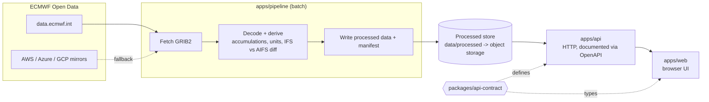

# Architecture (high level)

## Data flow in words

1. A new model run is published (IFS and AIFS, runs at 00/06/12/18 UTC).
2. The pipeline downloads only the precipitation fields it needs, decodes them, and derives what the UI wants (for example per-interval amounts rather than raw run-total accumulations).
3. It writes results plus a manifest describing which runs and steps are available.
4. The API reads that store and serves it. The web app renders it.

## Consequences of the upstream data (see `data-sources.md`)

- **We own history.** ECMWF keeps only the last 12 runs (about 2-3 days). Anything older exists only if the pipeline keeps it.
- **Publication is staggered.** IFS 0.1° arrives about 2 hours after 0.25°. The pipeline and manifest must handle a run being partially available.
- **Models differ in cadence.** AIFS is 6-hourly, IFS is 3-hourly early in the run. Comparison features need a common time base.
- **Upstream can be busy.** Mirrors on AWS, Azure and GCP are the fallback path.
